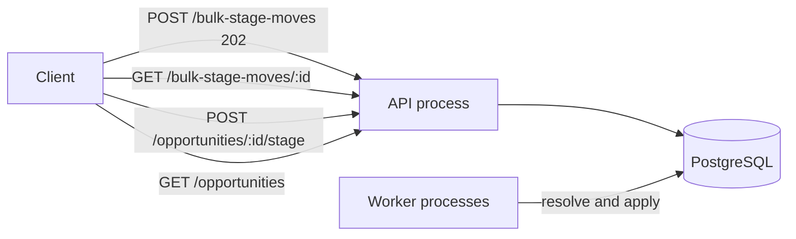
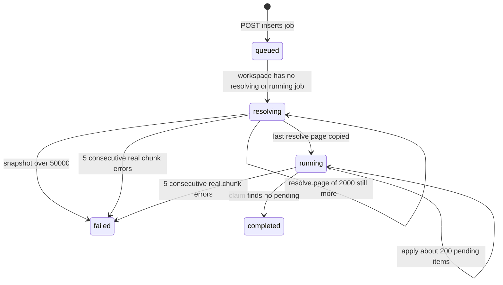
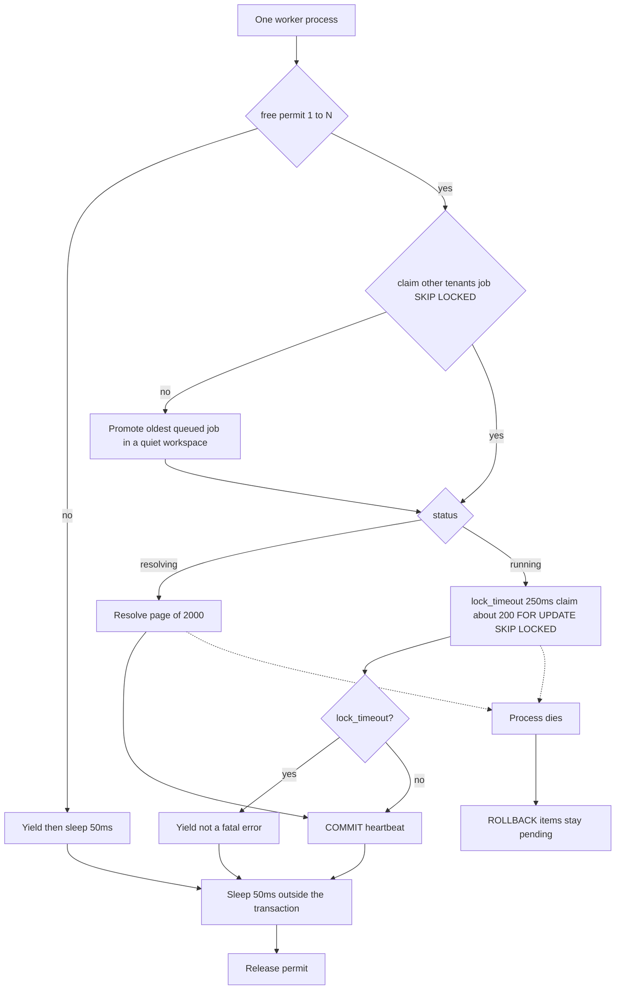
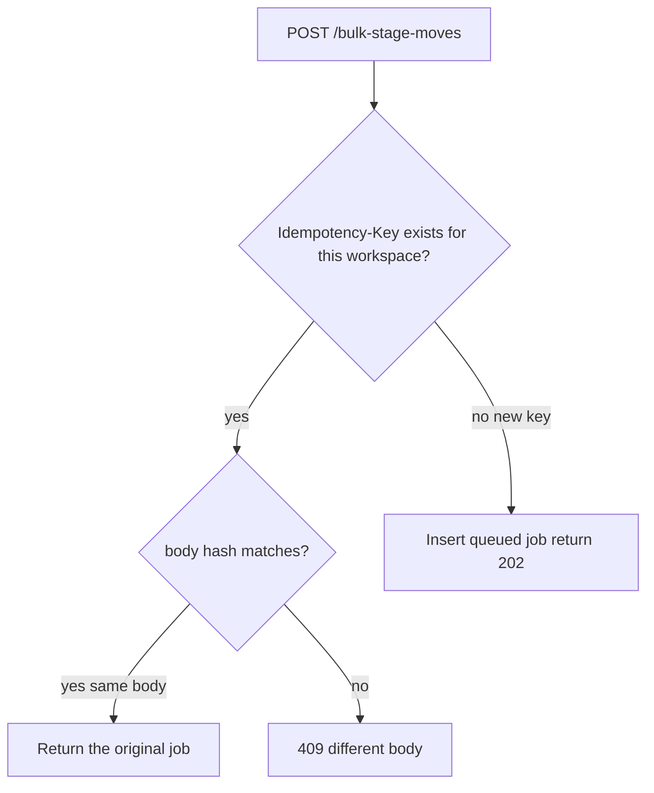
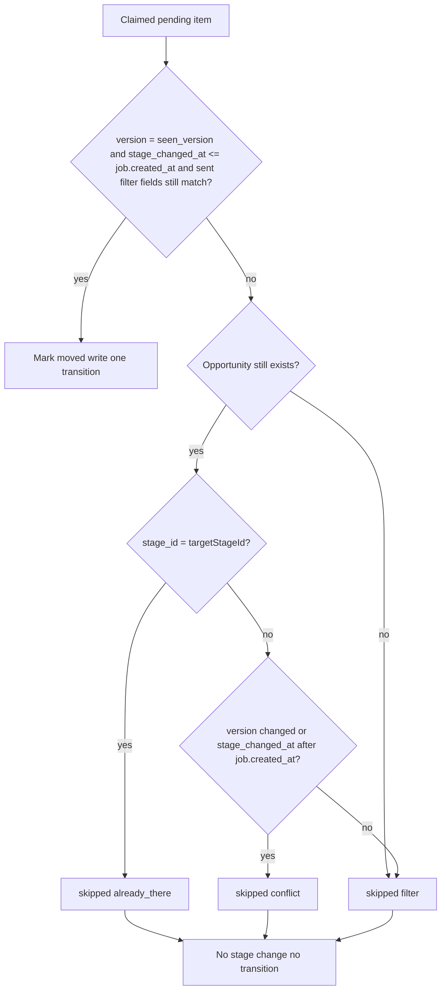
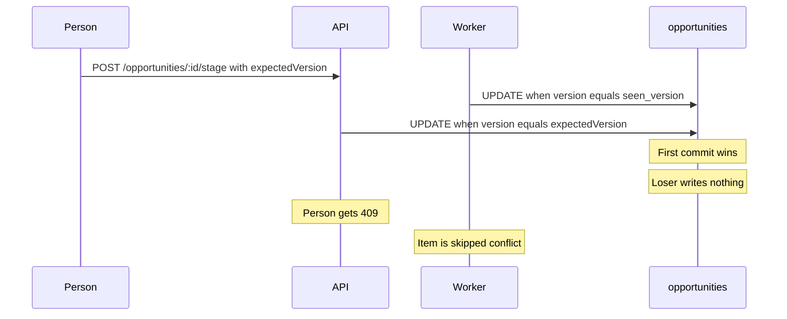
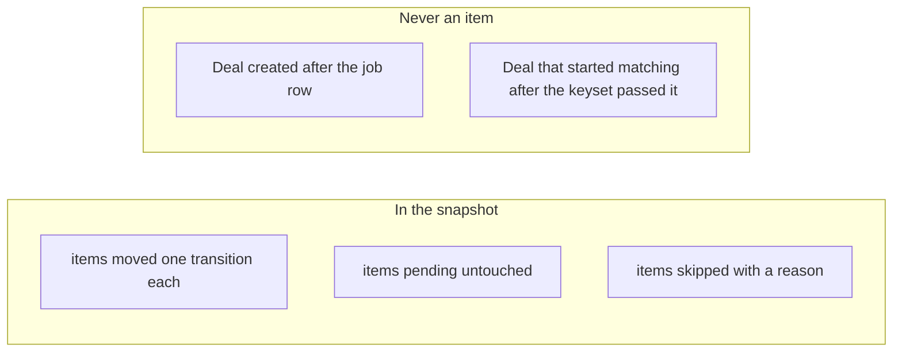
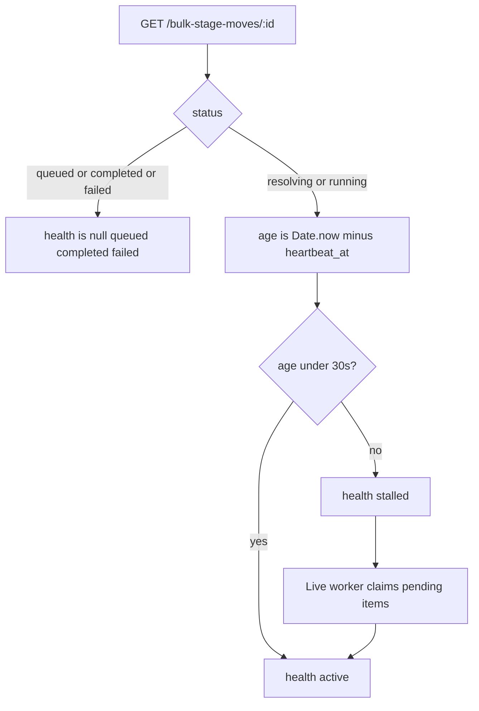

# Design: Bulk Stage Move

The product is one job: accept a filter, return a handle, move up to 50,000 matching opportunities to another stage in the background. This note is how that job is chunked, how it stays correct, and where it is still weak.

Stack: NestJS, TypeScript, `pg` (node-postgres). One API process and one or more worker processes, one codebase. PostgreSQL is the primary store and the queue. No Redis, no Kafka, no ORM owning the chunk SQL. Every request carries `X-Workspace-Id`. Stages are seeded rows; there is no stage API and no workspace API.

Working notes for each choice live in [docs/DECISIONS.md](docs/DECISIONS.md).

The API accepts the job and serves the poll, the single move, and list-by-stage. Worker processes copy the snapshot and change stages. Postgres holds `bulk_jobs`, `bulk_move_items`, `opportunities`, and `transitions`. A ninth open job in the same workspace is 429.

---

## How the job is chunked, and how the cursor survives a restart

`POST /bulk-stage-moves` inserts a `queued` job and returns 202 with the job id. The HTTP handler does not walk the matching set.

The worker does two phases.

**Resolve** copies the matching opportunity ids and the `version` it saw into `bulk_move_items`. It walks a keyset on the opportunity index, commits every 2,000 index entries, writes `heartbeat_at`, then sleeps 50ms outside the transaction. If the copy would exceed 50,000 rows, the job is `failed` before any stage change. After resolve, the item rows *are* the snapshot.

**Apply** claims about 200 `pending` items with `FOR UPDATE SKIP LOCKED`. In that same transaction it runs the conditional update on those opportunities, inserts one transition per moved row, and marks each item `moved` or `skipped`. Then it commits, heartbeats, and sleeps 50ms.

A crash rolls the open chunk back. Those items are still `pending`. Resume is: start the worker, claim whatever is still `pending`. There is no resume endpoint and no in-memory cursor.

Progress counts are `COUNT` over `bulk_move_items` by state. That is committed state. A process restart cannot invent a different number.

Ids are time-ordered uuidv7.

The index that makes **apply** cheap is `bulk_move_items (job_id, state, opportunity_id)`. Claim is a short range on that index, then primary-key updates on `opportunities`.

The index that makes **resolve** and list-by-stage cheap is `opportunities (workspace_id, stage_id, id)`. A filter with no stage walks `(workspace_id, id)`. There is no extra index per owner, status, or value; those predicates are applied on the walk. That is a deliberate write-cost choice on a 500,000-row seed, and it is the scan that fails first at 10× (below).

A process holds one of `MAX_IN_FLIGHT_CHUNKS` permits (`pg_try_advisory_lock` on keys `742901` through `742900 + N`) only for the duration of a chunk. `lock_timeout` is 250ms. A timeout is a yield: the worker retries later. It is not one of the five fatal chunk errors.

`failed` from the 50,000 cap happens before any stage change. `failed` from five chunk errors leaves already-committed moves in place.

---

## Idempotency

The key is a client `Idempotency-Key` plus a hash of the body, unique on `(workspace_id, key)`. The row lives in Postgres, so a restart still sees it.

- Same key, same body: return the original job, forever.
- Same key, different body: 409.
- A new click needs a new key.

What it protects: creating a second job for a retried POST. It does not, by itself, protect a deal. That is the version check.

Where a retry can still slip through: a client that retries with a **new** key. That inserts a second job. The version check still stops a row from moving twice (the second job sees a new `version` or a later `stage_changed_at` and skips). The two jobs split the set and the progress. A short same-body window is on the extra-week list; it is not in this submission.

Worker replay of a committed chunk does not double-apply. The item is no longer `pending`, and a transition is unique on `(job_id, opportunity_id)`.

A second job created with a new key still cannot move a deal the first job already moved: apply sees a new `version` or a later `stage_changed_at` and skips.

---

## One opportunity, and the manual-move collision

Resolve stores `seen_version` on the item.

Apply updates a row only when all of these hold:

- `version = seen_version`
- `stage_changed_at <= job.created_at` (both timestamps come from the database)
- every filter field the client actually sent still matches, including value and `created_at`

Otherwise the item is skipped: no stage change, no transition.

Skip reasons on the item:

- `conflict` — version or `stage_changed_at` moved since the job was created
- `filter` — a submitted filter field no longer matches
- `already_there` — the row is already in the target stage

A person moving a deal by hand sends `expectedVersion` and uses the same compare-and-swap. A stale client gets 409 and writes nothing. The job does not overwrite that person; the person does not overwrite a job apply that already committed.

---

## Snapshot vs live, and the consequence

The set is the ids resolve copies, not a live re-query of the filter.

Consequence: a deal created after the job row, or a deal that starts matching after the keyset has passed it, is not in the job. A deal that matched at resolve time is a candidate. If a person edits it before apply, the person wins and the item is skipped.

A half-applied job looks like this to the user:

- status `running` (or `resolving` if copy is unfinished)
- some items `moved`, each with one transition
- some items `pending`, untouched
- some items `skipped`, with a reason
- progress numbers that match those rows

“Finish correctly” after a kill at 30,000 of 50,000 means: the 30,000 committed moves stay, the uncommitted chunk is `pending` again, the remaining pending items are claimed, and no extra transition is written for a deal already moved by this job.

---

## Isolation, and the hole it still leaves

Mechanism, not a claim:

- Each worker is a separate OS process with one database connection. Killing one leaves the API and the other workers up.
- At most `MAX_IN_FLIGHT_CHUNKS` chunks in the whole system (default 4). Each process holds one permit only for that chunk.
- A process claims a `resolving` or `running` job with `FOR UPDATE SKIP LOCKED`, oldest `heartbeat_at` first. Two processes take two workspaces.
- One `resolving` or `running` job per workspace. A second job in that workspace stays `queued`. Queued is not stalled.
- A workspace may have 8 jobs that are not `completed` or `failed`. The next `POST` is 429.
- 50ms sleep after every committed resolve or apply chunk, outside the transaction.
- Every statement is scoped by `workspace_id`.

If only one workspace has work, free processes keep serving it, still one chunk at a time for that tenant. Extra permits sit idle.

The hole: it is still one Postgres. WAL and cache traffic from the large workspace can nudge latency in another workspace. We do not pretend a `WHERE workspace_id = $1` gives cache isolation. A read replica and partitioning are how we would close that hole; they are not in this submission.

[BENCHMARKS.md](BENCHMARKS.md) is a one-worker run. That number is still the N=1 floor. This change was not re-measured at N=4.

---

## Slow, stuck, failed

`GET /bulk-stage-moves/:id` returns status, `health`, `heartbeat_at`, and counts. Skip counts are split into conflict, filter, and already-there.

- `health=active` — last committed chunk is under 30s old
- `health=stalled` — last committed chunk is older than 30s; status stays `running` / `resolving`
- `failed` — terminal, and only for a snapshot over 50,000 (before any move) or 5 consecutive real chunk errors. Moves that already committed stay.

`heartbeat_at` is written by the database clock on the chunk commit. Health age is `Date.now()` minus that timestamp when the poll is served.

A queued job has no stall clock. A live worker claiming pending items is what clears a stall.

Health is not a status. Status stays `resolving` or `running` while stalled.

---

## HTTP, briefly

Every route requires `X-Workspace-Id`. Unknown workspace is 404.

| Method | Path | Notes |
|---|---|---|
| POST | `/opportunities` | name, value in integer cents, status, `ownerId`, `stageId`; returns `version` |
| POST | `/opportunities/:id/stage` | `stageId`, `expectedVersion`; stale version is 409 |
| GET | `/opportunities` | `stageId`, `limit`, `cursor` — keyset on opportunity id |
| POST | `/bulk-stage-moves` | `Idempotency-Key`; at least one filter field; `targetStageId`; 202 + job id; 429 if that workspace already has 8 open jobs |
| GET | `/bulk-stage-moves/:id` | status, health, heartbeat, counts |

Filter fields: `stageId`, `ownerId`, `status`, `valueMin`, `valueMax`, `createdAfter`, `createdBefore`. An empty filter is rejected.

---

## What breaks at 10×

A 500,000-row move is refused by the cap. Resolve stops at 50,001 and the job fails before any stage change.

If that cap were lifted, the apply loop would still finish. About 200 rows per chunk and a 50ms pause is slow — on the order of several minutes — and it stays correct. Throughput is not the first thing that fails.

The first real break is **resolve**, once one workspace has 20 million opportunities and the filter names no stage. One keyset chunk can walk millions of index entries, run past the 30s heartbeat, look stalled, hold a snapshot, and evict the shared cache other workspaces are using. Locks and the version check still hold.

Already in this submission: the 50,000 cap, and a 2,000-entry bound on every resolve chunk (commit the cursor, heartbeat, pause). That keeps resolve polite at seed size. It does not make a stageless walk over 20M cheap.

---

## Another week, ranked

1. **Partition `opportunities` by `workspace_id`.** Vacuum and index bloat stay with the heavy tenant. WAL is still shared; this is the first real isolation step.
2. **Adaptive pause.** Tighten or loosen the 50ms sleep once benchmarks show interactive latency climbing. Guessing the constant is worse than measuring it.
3. **Read replica for list-by-stage**, only if those numbers show the cache hole. Progress reads stay on the primary so a poll cannot lie.
4. **A short same-body dedupe window** for clients that retry with a new `Idempotency-Key`. An intentional rerun later in the day still starts a new job.

One in-flight chunk per workspace under a global ceiling is in this submission.

Redis, Kafka, UI, auth, and more CRM endpoints stay off this list. Skip reasons are in this submission; they are not the extra week.
